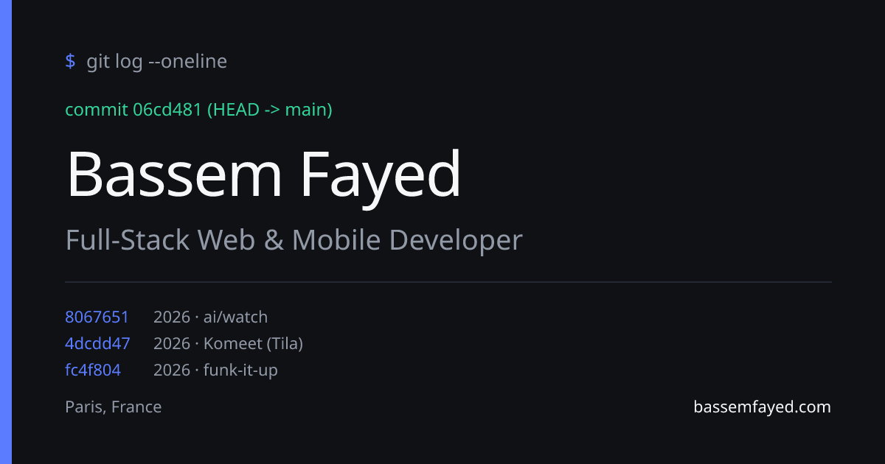
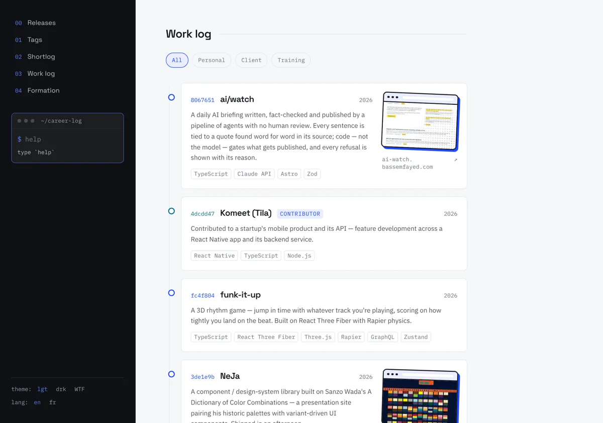

<div align="center">

# `$ git log` — Bassem Fayed

**Un portfolio qui se lit comme un historique de commits.**
Full-Stack Web & Mobile Developer · Paris

[**→ bassemfayed.com**](https://bassemfayed.com) · [FR](https://bassemfayed.com/fr) · [EN](https://bassemfayed.com/en) · [CV (PDF)](public/cv-bassem-fayed.pdf)




</div>

> 🇬🇧 **In short:** the source of my portfolio, [bassemfayed.com](https://bassemfayed.com). Projects, career and GitHub stats are presented as a commit log. Content is plain JSON in `/content` (no database, no admin, no login), served in English and French from Cloudflare Workers. [English summary below](#english-summary).

## Pourquoi ce site

Un CV tient sur une page ; un parcours, non. Ici, chaque projet est un « commit » avec son hash, ses jalons de carrière sont des « tags », et les chiffres clés sont tirés de GitHub. Le but : qu'un recruteur comprenne en quelques secondes ce que je construis, avec quelle stack, et depuis quand.

<div align="center">

</div>

## Points forts

- **Lecture façon `git log`** : projets triés du plus récent au plus ancien, hash court style git (cosmétique, déterministe), jalons de carrière en « tags », terminal intégré (`help`).
- **Bilingue FR / EN** : deux URLs (`/fr`, `/en`) rendues côté serveur, avec leurs propres `<html lang>`, canonical et hreflang ; `/` redirige selon un cookie puis `Accept-Language`.
- **Trois thèmes** : clair, sombre, et un mode « WTF » en three.js, chargé à la demande seulement pour qui le choisit.
- **Vignettes cliquables** : chaque expérience, formation ou projet peut porter une fenêtre de navigateur qui mène à la page publique concernée (capture réelle pour mes propres sites, scène dessinée pour les sites de clients).
- **Chiffres vivants** : contributions, dépôts publics et PR fusionnées viennent de l'API GitHub ; les années d'expérience se calculent à la volée.
- **Carte de partage dédiée** (Open Graph / Twitter) générée par le code, et un CV PDF d'une page à télécharger.
- **Zéro back-end** : le contenu est du JSON typé, la mise à jour est un commit.

## Stack

| Couche | Choix |
| --- | --- |
| Framework | Next.js 15 (App Router), React 19, composants serveur par défaut |
| Langage | TypeScript `strict`, types de contenu dans `lib/types.ts` |
| Style | Tailwind CSS 3 avec design tokens uniquement |
| 3D | three.js (mode « WTF ») |
| Déploiement | Cloudflare Workers via [vinext](https://github.com/cloudflare/vinext) et Wrangler |
| Tests | Vitest (cohérence FR/EN, tri, visuels, règles de confidentialité) |
| Automatisation | GitHub Actions : rafraîchissement hebdomadaire des stats |

## Le contenu, c'est du JSON

| Fichier | Contenu |
| --- | --- |
| `content/profile.json` | Nom, accroche, résumé, liens |
| `content/projects.json` | Le « Work log » |
| `content/experience.json` | Parcours professionnel |
| `content/stats.json` | Chiffres clés : `manual` (à la main) et `live` (API GitHub) |

Chaque fichier a son jumeau français dans `content/fr/`. Ajouter un projet, c'est copier une entrée de `projects.json`, la modifier dans les deux langues, puis committer.

## Lancer en local

```bash
npm install
npm run dev      # http://localhost:3001
npm test         # Vitest
npm run build    # doit passer avant tout commit
```

## Déployer

```bash
npm run deploy   # build vinext + publication sur Cloudflare Workers
```

Nécessite `npx wrangler login` une fois par machine. Chaque lundi à 06:00 UTC, le workflow `refresh` met à jour les chiffres GitHub, lance les tests et le build, committe puis déploie. Le push seul ne déploie pas.

## Confidentialité

Le site ne nomme ni ne lie aucun dépôt privé d'employeur ou de client. Les chiffres issus de contributions privées sont des totaux, sans nom de dépôt. Seules mes propres pages (`*.bassemfayed.com`) utilisent de vraies captures ; un test le garantit.

Les conventions de contribution (pour humains et agents IA) sont dans [`AGENTS.md`](AGENTS.md).

## English summary

**career-log** is the source of [bassemfayed.com](https://bassemfayed.com), my portfolio, designed to read like a `git log`: projects are commits, career milestones are tags, headline numbers come from GitHub.

- Next.js (App Router) · TypeScript strict · Tailwind · deployed on Cloudflare Workers via vinext
- Content is typed JSON in `/content`, with a French twin in `/content/fr`; both `/en` and `/fr` are server-rendered
- Light, dark and a lazy-loaded three.js "WTF" theme; clickable browser-window thumbnails; generated Open Graph card
- Weekly GitHub Action refreshes live stats, runs tests and build, then deploys
- No private employer or client repo is ever named or linked

```bash
npm install && npm run dev   # http://localhost:3001
```
